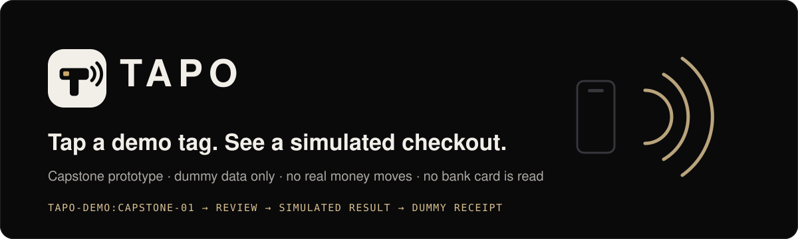
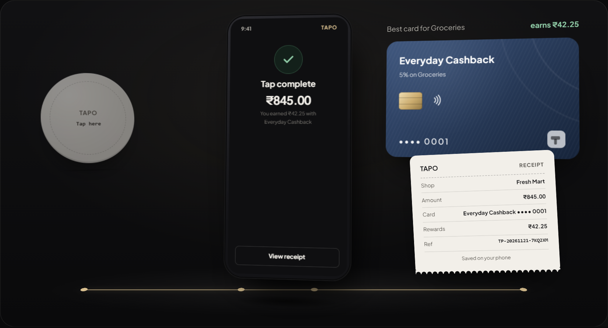
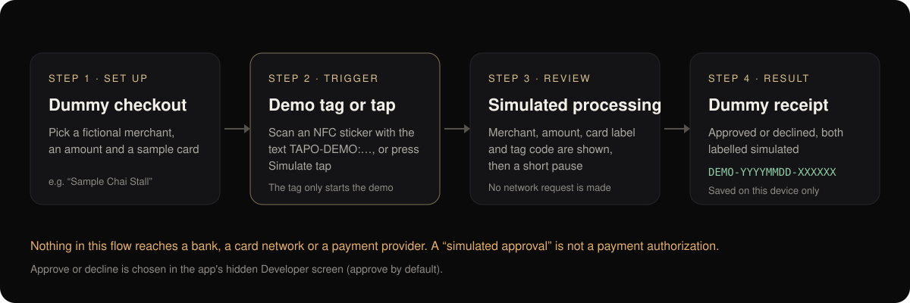

<p align="center">
  
</p>

<p align="center">
  <strong>A capstone prototype that demonstrates an NFC-triggered, fully simulated payment flow,<br>inside a rewards wallet that tells you which card to use.</strong>
</p>

<p align="center">
  <a href="https://docs.expo.dev/versions/v58.0.0/">Expo SDK 58</a> ·
  React Native 0.88 ·
  TypeScript ·
  iOS · Android · Web
</p>

<p align="center">
  <a href="https://tapo-seven.vercel.app/showcase/"><strong>Live showcase</strong></a> ·
  <a href="https://tapo-seven.vercel.app/">Website</a> ·
  <a href="https://tapo-seven.vercel.app/app/">Web app</a>
</p>

> [!IMPORTANT]
> **TAPO does not process payments.** Every merchant, amount, card and receipt in the demo is fictional.
> NFC is used only as a *trigger* for the demo: the app reads a short text code from an ordinary NFC sticker.
> It never reads, emulates or charges a contactless bank card, and a “simulated approval” is not a payment
> authorization from any bank or card network.

## Contents

- [See the demo in motion](#see-the-demo-in-motion)
- [What TAPO is](#what-tapo-is)
- [The tap-to-pay demo](#the-tap-to-pay-demo)
- [Where NFC works, and where it falls back](#where-nfc-works-and-where-it-falls-back)
- [Try it with a real NFC tag](#try-it-with-a-real-nfc-tag)
- [Run the project](#run-the-project)
- [Data, accounts and privacy](#data-accounts-and-privacy)
- [Tech stack and structure](#tech-stack-and-structure)
- [Checks and tests](#checks-and-tests)
- [Limits of this prototype](#limits-of-this-prototype)

## See the demo in motion

<p align="center">
  <a href="https://tapo-seven.vercel.app/showcase/"></a>
</p>

<p align="center"><a href="https://tapo-seven.vercel.app/showcase/"><strong>Open the live, animated version →</strong></a></p>

GitHub can't run the animation, so the image above is a still of its last step. The
[live page](https://tapo-seven.vercel.app/showcase/) plays the whole flow in 3D:
**tag → phone → checkout → best card and receipt**. The card shown is the one TAPO's rewards engine picks for the
purchase. You can pause it or step through it, and with *reduce motion* turned on it shows the finished flow
without playing. The page is written as product marketing; like everything in this repository, the shop, amount,
card and receipt it shows are fictional, and the flow it depicts is the simulated demo described below.

## What TAPO is

TAPO is an India-focused **multi-card rewards wallet** built as an educational capstone project. You add your
cards with their reward rates and monthly caps (never the card number), and TAPO:

- **recommends the best card** for a purchase, explaining why and accounting for caps already used this month;
- **imports a bank or card statement CSV** on the device and shows the rewards you missed by using the wrong card;
- **demonstrates an NFC-triggered checkout** with dummy data: the part this README focuses on.

It runs as an iOS and Android app (Expo) and on the web, with a public marketing site and the web app served at
`/app`.

## The tap-to-pay demo

<p align="center">
  
</p>

Open it from **Wallet → Tap-to-pay demo**, or **Card details → Pay → Try the tap-to-pay demo**
([`src/app/demo-pay.tsx`](src/app/demo-pay.tsx)).

| Step | What happens |
| --- | --- |
| **1 · Set up** | Choose a fictional merchant (for example “Sample Chai Stall”), an amount and one of your sample cards. |
| **2 · Trigger** | Hold a demo NFC tag to the phone, or press **Simulate tap**. The tag must hold a text record starting with `TAPO-DEMO:`. |
| **3 · Review** | The screen shows the merchant, amount, card label and tag code, then a short *simulated* processing step. |
| **4 · Result** | A result labelled *simulated*: approved by default, or declined if set in the hidden **Developer** screen. |
| **Receipt** | A dummy receipt with an ID like `DEMO-20261121-7KQ2XM`, saved only on the device. |

Every demo screen carries the banner **“Demo mode — no real money is charged”**. The last 50 demo receipts are
kept locally, and **Recent demo receipts → Clear demo receipts** deletes them. Nothing is sent over the network.

### What the tag check accepts

Tag parsing lives in [`src/lib/demoNfc.ts`](src/lib/demoNfc.ts) and is covered by unit tests:

- one NDEF **text** record that starts with `TAPO-DEMO:`;
- a code after the prefix of 3–32 letters, numbers or dashes (for example `TAPO-DEMO:CAPSTONE-01`);
- tags whose code contains **12 or more digits are rejected**, so nothing that looks like a card number is ever
  accepted.

The demo handles these cases with clear messages: NFC permission denied, a tag with the wrong text, a cancelled
scan, a timeout, NFC switched off, and devices or browsers without NFC.

## Where NFC works, and where it falls back

| Where TAPO runs | NFC tag scanning | What the demo does |
| --- | --- | --- |
| **Chrome on Android**, over HTTPS or `localhost` | Yes, via [Web NFC](https://developer.mozilla.org/docs/Web/API/Web_NFC_API) (`NDEFReader`) | Scan a demo tag, or Simulate tap |
| **Android app** (development or release build) | Yes, via `react-native-nfc-manager` | Scan a demo tag, or Simulate tap |
| **iPhone app** (development or release build) | Yes, through the iOS scanning sheet; needs a paid Apple Developer account to sign the NFC entitlement | Scan a demo tag, or Simulate tap |
| **Safari and every iOS browser** | No (no Web NFC on iOS) | Explains why, then **Simulate tap** |
| **Desktop browsers** | No | **Simulate tap** |
| **Expo Go** | No (it can't load the NFC module) | Says a development build is needed, then **Simulate tap** |
| Android over plain `http://` on a LAN address | No (Web NFC needs a secure context) | Explains the HTTPS requirement, then **Simulate tap** |

**Simulate tap** runs exactly the same review → processing → result → receipt flow, so the demo works anywhere.

The native app reads NDEF text only. The config plugin in [`app.json`](app.json) adds the Android `NFC` permission,
the iOS `NFCReaderUsageDescription` text and the `com.apple.developer.nfc.readersession.formats` entitlement. No
ISO 7816 application identifiers are declared, so the app **cannot select payment applications on a card**.

## Try it with a real NFC tag

1. **Get a blank tag.** Any NFC Forum sticker or card works (for example NTAG213).
2. **Write one text record** with a free tag-writing app such as *NFC Tools*:

   ```text
   TAPO-DEMO:CAPSTONE-01
   ```

   > Never write card numbers, PINs or any other payment data to a tag. TAPO rejects tags that contain long numbers.

3. **Open TAPO on a phone that can scan** (see the table above):
   - **Android + Chrome:** open the app over HTTPS (your Vercel deployment's `/app`), or over `localhost` using USB
     port forwarding: enable USB debugging, open `chrome://inspect/#devices` on your computer, forward
     `8081 → localhost:8081`, run `npm run web`, then open `http://localhost:8081` in Chrome on the phone.
   - **Native app:** install a development build (below) and start it with `npx expo start --dev-client`.
4. In the demo, choose a merchant and amount → **Continue to tap** → **Scan demo NFC tag**, allow NFC if asked, and
   hold the tag to the back of the phone (near the top on iPhone). The tag code appears on the review screen and
   receipt.

## Run the project

Requirements: **Node.js 20+** and npm. For phones: the **Expo Go** app, or a development build for NFC scanning.

```bash
npm install
npm start          # dev server; scan the QR code with Expo Go
npm run web        # web app at http://localhost:8081
npm run android    # Android emulator or device (Android Studio)
npm run ios        # iOS Simulator (macOS + Xcode)
```

Everything runs in Expo Go **except native NFC scanning**, which needs a development build:

```bash
npx eas-cli@latest init                                              # once: link to your Expo account
npx eas-cli@latest build --profile development --platform android   # installable dev build (APK)
npx expo start --dev-client                                          # then open TAPO from that build
```

Locally you can also use `npx expo run:android` or, on macOS with Xcode, `npx expo run:ios --device`.
Profiles are defined in [`eas.json`](eas.json). Replace the placeholder `com.example.tapo` identifiers in
`app.json` before distributing a build.

### Production web build

```bash
npm run build:web                   # Expo web app → dist/app, plus the pre-rendered public site → dist/
npm run serve:dist                  # serve dist/ on http://localhost:4173 the way Vercel does
```

The showcase is part of the public site, at `/showcase/` (open <http://localhost:4173/showcase/> locally). To
rebuild only the site after editing it, run `npm run build:site`. Add `?step=1` to `?step=4` to the URL to open a
step paused; that's how [`docs/readme/showcase.png`](docs/readme/showcase.png) was captured.

[`vercel.json`](vercel.json) uses `npm run build:web`, serves `dist/`, routes `/app/*` to the web app and sets
security headers. No environment variables are required; `SITE_URL` is optional and only makes link-preview URLs
absolute.

## Data, accounts and privacy

- **No real payment data exists in TAPO.** The data model has no fields for a full card number, CVV, PIN, OTP,
  expiry date, bank login or payment token. Cards keep a nickname and the last four digits as a label, and
  nicknames that look like card numbers are rejected.
- **Sample data is labelled.** The app starts with four fictional sample cards (issuers such as “Sample Bank
  Alpha”) and sample transactions, marked as samples in the UI.
- **Accounts are on the device.** Signing up stores a name, email, salt and a password verifier; the password is
  never stored. The wallet is encrypted with **AES-256-GCM** using a key derived from the password (PBKDF2), held
  only in memory ([`src/lib/auth.tsx`](src/lib/auth.tsx), [`src/lib/vault.ts`](src/lib/vault.ts)).
- **Sessions lock themselves** after 10 minutes without activity. Five wrong passwords pause sign-in for
  30 seconds. On the web a session survives a refresh within the same tab; restarting the native app asks for the
  password again. Forgotten passwords can't be recovered: **Can't sign in?** removes that account and its data.
- **Statement imports stay on the device.** Only the date, merchant and amount are kept; long numbers such as
  account or UPI references are masked to their last four digits.
- There are no analytics, ads or network calls with your data.

## Tech stack and structure

| Layer | Used here |
| --- | --- |
| App | Expo SDK 58, React Native 0.88, React 19, TypeScript, Expo Router |
| NFC | Web NFC (`NDEFReader`) on the web; `react-native-nfc-manager` 4 in native builds |
| Storage and crypto | AsyncStorage, `expo-crypto` (AES-256-GCM), PBKDF2-SHA256 |
| Graphics | `react-native-svg` for card faces, icons and the logo |
| Public site | Static pages pre-rendered by [`site/build.mjs`](site/build.mjs) using the app's own logic; the showcase's 3D is CSS transforms with no extra libraries |
| Quality | Jest (`jest-expo`), Playwright end-to-end tests, ESLint, GitHub Actions CI |
| Hosting | Vercel (static `dist/`) |

```text
src/app/              Screens (Expo Router). demo-pay.tsx is the tap-to-pay demo.
src/lib/demoNfc.ts    Tag parsing, support detection and Web NFC scanning
src/lib/nativeNfc.*   Native NFC (iOS/Android) and the web stub
src/lib/              Rewards engine, insights, CSV import, accounts, encrypted storage
src/lib/__tests__/    Unit tests
site/                 Public site (Home, Product, Showcase, Security, FAQ); showcase.css/.js drive the 3D demo
e2e/                  Playwright tests for the site and the web app
docs/                 Architecture guide, research kit, AI usage declaration, README images
```

More detail: [`docs/ARCHITECTURE.md`](docs/ARCHITECTURE.md) walks through each module.

## Checks and tests

```bash
npm run typecheck   # TypeScript
npm run lint        # ESLint (expo lint)
npm test            # Jest unit tests, including NFC tag parsing
npm run test:e2e    # Playwright, against dist/ (run npm run build:web first)
```

Locally, Playwright uses the installed Microsoft Edge (see [`playwright.config.ts`](playwright.config.ts)).
CI runs typecheck, lint, tests and a web build on every push ([`.github/workflows/ci.yml`](.github/workflows/ci.yml)).

## Limits of this prototype

- **It is not a payment product.** There is no payment provider, card network, tokenisation, card provisioning or
  host card emulation, and none is planned in this repository.
- **The demo result is chosen, not computed.** Approve or decline comes from a developer setting, purely to show
  both outcomes.
- **NFC support depends on the device and browser**, as listed above. iOS browsers cannot scan tags at all.
- Reward rates are entered by the user; estimates are illustrative and are not issuer statements or financial
  advice.

A real contactless payment product would need, at minimum, regulated issuer and payment partners in India (RBI rules,
card tokenisation, KYC and data protection), card-network certification, platform wallet approval from Google or
Apple, PCI DSS scope and security audits, and dispute and support operations.

---

<sub>Capstone prototype. All issuers, cards, merchants, amounts and receipts shown in TAPO are fictional sample data.
TAPO is not affiliated with any bank, card network or payment provider.</sub>
